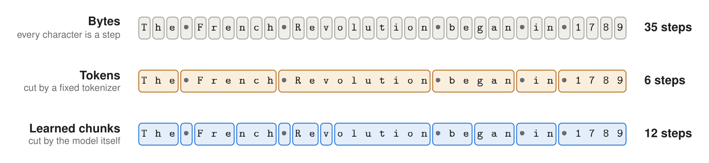
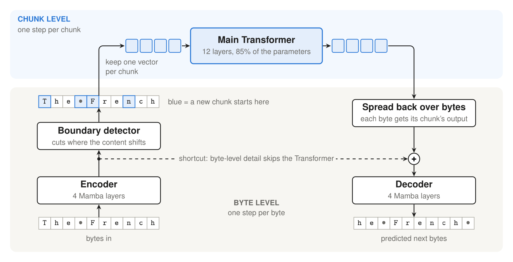

# bytegpt: can a model learn its own tokenizer?

Three language models of about 100M parameters, trained on the same text with
the same compute, that differ only in how they read it:

| Model | Reads text as | Who decides the units |
|---|---|---|
| Byte Transformer | single bytes | nobody, every byte is a step |
| BPE Transformer | tokens from a 32k vocabulary | a tokenizer built before training |
| H-Net | chunks of bytes | the model, while it trains |

It is a small-scale replication of Cartesia's
[From Tokens to Bytes](https://www.cartesia.ai/blog/from-tokens-to-bytes-part-1)
posts and the [H-Net paper](https://arxiv.org/abs/2507.07955), run on two RTX 3090s.

Article: [Can a model learn its own tokenizer?](https://claude.ai/artifact/AamTLQSJGp6uYueALTKjtm)

## Results

Each model got about 1.0e19 floating-point operations of training. Lower is
better in every row except HellaSwag.

| | [Byte Transformer](https://huggingface.co/ShadeEngine/bytegpt-byte-85M) | [BPE Transformer](https://huggingface.co/ShadeEngine/bytegpt-bpe32k-110M) | [H-Net](https://huggingface.co/ShadeEngine/bytegpt-hnet-100M) |
|---|---:|---:|---:|
| FineWeb-Edu validation, bits per byte | 1.036 | 0.922 | 0.913 |
| English Wikipedia, bits per byte | 1.118 | 0.988 | 1.034 |
| French Wikipedia, bits per byte | 1.944 | 1.836 | 1.865 |
| Python code, bits per byte | 1.329 | 1.382 | 1.521 |
| HellaSwag accuracy (1,000 questions, chance is 25%) | 35.7% | 38.7% | 38.8% |
| Typo penalty (loss with 1% typos / clean loss) | 1.240 | 1.280 | 1.241 |

The short version: the H-Net matches the BPE model on the training
distribution without being given a tokenizer, and it keeps the byte model's
tolerance to typos. It loses to BPE on Wikipedia and French, and to both on
Python code.

Bits per byte is the loss divided by the bytes of text it covers. It lets
models with different vocabularies share one scale. Karpathy's
[nanochat](https://github.com/karpathy/nanochat) uses the same metric for the
same reason.

Read these numbers with three limits in mind:

- One run per model. A gap of a percent or two could be noise.
- The H-Net settled at 3.7 bytes per chunk, below the 4.6 it was aimed at.
  Shorter chunks cost more compute per byte, so it saw 38 GB of text against
  60 GB for the BPE model.
- HellaSwag uses the first 1,000 validation questions. The error bar is about
  ±3 points.

Everything behind the table is in [`results/`](results):

| File | Holds |
|---|---|
| `eval_byte.json`, `eval_bpe.json`, `eval_hnet.json` | Full benchmark output and text samples for each model |
| `chunks_hnet.txt` | Where the H-Net cuts sample texts, and its chunk size per domain |
| `val_curves.csv` | Validation loss during training, every 500 steps |
| `logs/` | Training logs, one line every 20 steps |

## Models and data

| | Hugging Face |
|---|---|
| Byte Transformer, 85M | [ShadeEngine/bytegpt-byte-85M](https://huggingface.co/ShadeEngine/bytegpt-byte-85M) |
| BPE Transformer, 110M | [ShadeEngine/bytegpt-bpe32k-110M](https://huggingface.co/ShadeEngine/bytegpt-bpe32k-110M) |
| H-Net, 100M | [ShadeEngine/bytegpt-hnet-100M](https://huggingface.co/ShadeEngine/bytegpt-hnet-100M) |
| Training text as bytes, 45 GB | [ShadeEngine/fineweb-edu-bytes-10BT](https://huggingface.co/datasets/ShadeEngine/fineweb-edu-bytes-10BT) |
| Training text as tokens | [ShadeEngine/fineweb-edu-bpe32k-10BT](https://huggingface.co/datasets/ShadeEngine/fineweb-edu-bpe32k-10BT) |

The benchmark runs straight from the Hub:

    python evaluate.py --ckpt hf:ShadeEngine/bytegpt-byte-85M
    python evaluate.py --ckpt hf:ShadeEngine/bytegpt-bpe32k-110M --tokenizer tokenizer_32k.json
    .venv-hnet/bin/python evaluate.py --ckpt hf:ShadeEngine/bytegpt-hnet-100M
    .venv-hnet/bin/python chunk_viz.py --ckpt hf:ShadeEngine/bytegpt-hnet-100M

## How the comparison is kept fair

**Same text.** All three train on FineWeb-Edu `sample-10BT`. The byte shards
and the token shards encode the same documents with the same validation split.

**Same compute, not same steps.** A byte model takes 4.6 steps where the BPE
model takes one, so equal step counts would not be equal work. Each run is
sized to about 1.0e19 FLOPs instead, counted as
`6 × parameters + 6 × layers × context × width` per step of the network
(`train.py`). That buys different amounts of text:

| Model | Parameters | Optimizer steps | Text seen |
|---|---:|---:|---:|
| Byte Transformer | 85.2M | 20,000 | 10.5 GB |
| BPE Transformer | 110.1M | 25,000 | 60 GB |
| H-Net | 99.8M | 72,800 | 38.2 GB |

**Same backbone.** The byte and BPE models are the same 12-layer Transformer
(`model.py`). Only the vocabulary and context length change. The H-Net's main
network is also a 12-layer Transformer of width 768.

**Same benchmark.** `evaluate.py` scores every model on the same frozen 5 MB
test sets, in bits per byte, through one adapter per model type.

## The H-Net

The H-Net comes from the official code at
[goombalab/hnet](https://github.com/goombalab/hnet). That repo ships the model
but no training loop, so `hnet_train.py` adds one: next-byte cross-entropy
plus the paper's ratio loss, which nudges the chunk size toward a target
without saying where to cut. The layout is in `configs/hnet_small.json`.

## Run it yourself

Two Python 3.12 environments are needed, because the H-Net's dependencies pin
an older PyTorch.

    python -m venv .venv
    .venv/bin/pip install -r requirements.txt

    python -m venv .venv-hnet
    .venv-hnet/bin/pip install -r requirements-hnet.txt
    git clone https://github.com/goombalab/hnet repos/hnet
    git -C repos/hnet checkout 3673fe1

Prepare the data, about 45 GB of bytes plus 20 GB of tokens:

    python prepare_fineweb_bytes.py     # FineWeb-Edu as uint8 shards
    python train_tokenizer.py           # 32k BPE tokenizer from 2 GB of it
    python tokenize_data.py             # the same documents as uint16 token shards
    python prepare_eval_data.py         # frozen test sets in eval_data/

Train. Each command uses both GPUs. The first two take about a day each on
two RTX 3090s, the H-Net about two and a half days.

    torchrun --standalone --nproc_per_node=2 train.py --preset small \
        --max-iters 20000 --out-dir runs/small-10B

    torchrun --standalone --nproc_per_node=2 train.py --preset small-bpe \
        --data-dir data/fineweb_edu_bpe --micro-bs 8 --grad-accum 16 \
        --max-iters 25000 --out-dir runs/bpe-13B

    ./run_hnet.sh                       # restarts from the last checkpoint after a crash

Add `--no-wandb` to train without Weights & Biases. To try the code quickly,
`--preset micro --max-iters 50` and `configs/hnet_micro.json` run in a minute.

Evaluate:

    python evaluate.py --ckpt runs/small-10B/ckpt.pt --out results/eval_byte.json
    python evaluate.py --ckpt runs/bpe-13B/ckpt.pt --tokenizer tokenizer_32k.json --out results/eval_bpe.json
    .venv-hnet/bin/python evaluate.py --ckpt runs/hnet-44B/ckpt.pt --out results/eval_hnet.json
    .venv-hnet/bin/python chunk_viz.py --ckpt runs/hnet-44B/ckpt.pt

## Files

| File | Does |
|---|---|
| `model.py` | The Transformer used for the byte and BPE models |
| `train.py`, `data.py` | Training loop and data loading for those two |
| `hnet_train.py`, `run_hnet.sh`, `configs/` | H-Net training |
| `evaluate.py` | The benchmark: bits per byte on four domains, HellaSwag, typo test, samples |
| `chunk_viz.py` | Prints where the H-Net cuts text |
| `prepare_fineweb_bytes.py`, `train_tokenizer.py`, `tokenize_data.py`, `prepare_eval_data.py` | Data preparation |
| `export_hf.py`, `model_cards.py`, `upload_to_hf.py` | Publishing to Hugging Face |
| `tokenizer_32k.json` | The BPE tokenizer |
| `article/` | TikZ sources of the article's figures |

## Credits

- The H-Net architecture and code: Hwang, Wang and Gu,
  [Dynamic Chunking for End-to-End Hierarchical Sequence Modeling](https://arxiv.org/abs/2507.07955)
  and [goombalab/hnet](https://github.com/goombalab/hnet)
- The experiment design: Cartesia's
  [From Tokens to Bytes](https://www.cartesia.ai/blog/from-tokens-to-bytes-part-1) and
  [part 2](https://www.cartesia.ai/blog/from-tokens-to-bytes-part-2)
- The training setup borrows from Karpathy's
  [nanoGPT](https://github.com/karpathy/nanoGPT) and
  [nanochat](https://github.com/karpathy/nanochat)
- Data: [FineWeb-Edu](https://huggingface.co/datasets/HuggingFaceFW/fineweb-edu)
